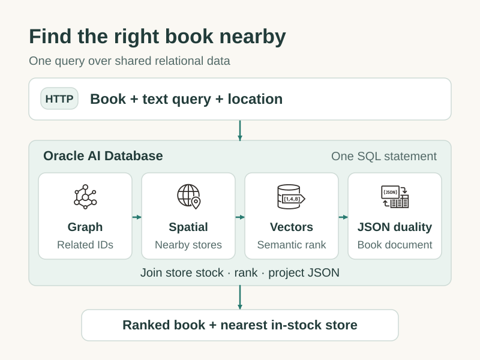
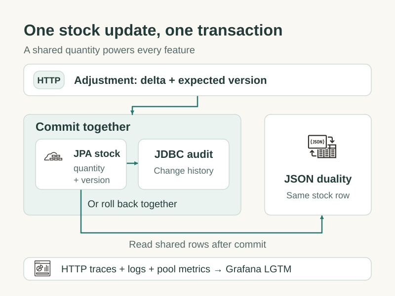

# Spring Boot Reference Application for Oracle AI Database

Find related books matching a description and available at a nearby store. This sample combines graph, spatial, vector search, and JSON duality over one catalog, with transactional JPA/JDBC inventory updates.

## Start

Requires Java 21+, Maven, Docker Compose, and `curl`/`jq` for the walkthrough. From this module's directory, replace the password placeholders below:

```bash
export ORACLE_PASSWORD='<DB admin password>'
export DB_PASSWORD='<App schema password>'
export APP_PASSWORD='<API password>'

docker compose up -d --wait
mvn spring-boot:run
```

The API listens on `127.0.0.1:8080`; Oracle AI Database Free listens on `localhost:1522`. Compose creates `REFERENCE_APP` and grants graph/view privileges. Spring Boot runs [reset.sql](https://github.com/anders-swanson/oracle-database-code-samples/blob/main/oracle-reference-spring-boot-app/src/main/resources/reset.sql), [schema.sql](https://github.com/anders-swanson/oracle-database-code-samples/blob/main/oracle-reference-spring-boot-app/src/main/resources/schema.sql), then [data.sql](https://github.com/anders-swanson/oracle-database-code-samples/blob/main/oracle-reference-spring-boot-app/src/main/resources/data.sql). Hibernate validates the result. A small [embedding runner](https://github.com/anders-swanson/oracle-database-code-samples/blob/main/oracle-reference-spring-boot-app/src/main/java/com/example/reference/vector/DemoEmbeddings.java) embeds all eight seeded book synopses locally before the app becomes ready.

The seed data contains eight books, four authors, three publishers, three stores, and recommendation/availability examples.

All names, titles, synopses, and businesses are fictional test data. The ISBN fields contain invented 13-digit identifiers, not issued ISBNs, and store coordinates are synthetic WGS84 test points. Every seeded book has an embedding; exclusion examples use graph relationships, distance, and stock.

Follow the [discovery walkthrough](https://github.com/anders-swanson/oracle-database-code-samples/blob/main/oracle-reference-spring-boot-app/LAB.md) to find a related book nearby, sell the closest store’s remaining copies, and watch the next search select another store. If you need to restore the demo, simply restart the app to create-drop the schema and seed data.

## How the features interact



1. **Local embeddings:** startup embeds every seeded synopsis with AllMiniLM; each search embeds the query with the same 384-dimensional model before acquiring a database connection.
2. **Graph + spatial + inventory:** `graph_table` finds books one or two recommendations away. Spatial finds stores inside the requested radius. Ordinary joins keep positive stock at those stores.
3. **Vector ranking + nearest store:** `vector_distance` ranks the eligible books by meaning; `row_number` selects the nearest in-stock store per book.
4. **JSON duality:** the result includes a nested document with current authors, publisher, and availability from the same relational rows. Its availability includes all stores, while the top-level store is the matched location.

The database work is **one SQL statement with one consistent snapshot**. The graph and duality view describe existing rows; no data synchronization services are needed. The diagram shows logical roles, not an imposed optimizer execution order.

## Try a transaction

Create a book and its inventory entry, then adjust that entry:

```bash
export APP_PASSWORD='<API password>'
base=http://127.0.0.1:8080
user=${APP_USERNAME:-developer}

book=$(curl -fsS -u "$user:$APP_PASSWORD" -H 'Content-Type: application/json' \
  -d '{"isbn":"0000000000031","title":"Demo Practical Java Services"}' \
  "$base/api/books" | jq -er .id)
store=$(curl -fsS -u "$user:$APP_PASSWORD" --get \
  --data-urlencode 'longitude=-30.0000' --data-urlencode 'latitude=35.0000' \
  --data-urlencode 'radiusKm=5' "$base/api/stores" | jq -er '.[] | select(.storeName == "Demo Willow Quay Books") | .storeId')

stock=$(curl -fsS -u "$user:$APP_PASSWORD" -H 'Content-Type: application/json' \
  -d '{"quantity":10}' "$base/api/stores/$store/books/$book")
version=$(jq -er .version <<< "$stock")

curl -fsS -u "$user:$APP_PASSWORD" -H 'Content-Type: application/json' \
  -d "{\"delta\":-3,\"expectedVersion\":$version}" \
  "$base/api/stores/$store/books/$book/stock-adjustments" | jq '{quantity, version}'
```

Expect quantity `7`, version `1`. JPA updates the versioned stock row and JDBC inserts its audit record in the same transaction. Both commit or both roll back. Reusing the old version returns `409 Conflict`. Read the audit history with `GET /api/stores/{storeId}/books/{bookId}/stock-adjustments` (newest first, default limit 20).



`StockService` uses one Spring-managed transaction: JPA changes the quantity/version and `JdbcClient` writes the audit entry on the same connection. After commit, discovery and the duality document see the new quantity directly. HTTP and JDBC driver traces, application logs, and UCP metrics are exported to Grafana LGTM by default.

## Explore the code

| Package | Purpose | Entry point |
| --- | --- | --- |
| `book` | Catalog DTOs, shared authors/publishers, bounded paging | [BookService](https://github.com/anders-swanson/oracle-database-code-samples/blob/main/oracle-reference-spring-boot-app/src/main/java/com/example/reference/book/BookService.java) |
| `stock` | The single inventory count, optimistic locking, JPA/JDBC audit transaction | [StockService](https://github.com/anders-swanson/oracle-database-code-samples/blob/main/oracle-reference-spring-boot-app/src/main/java/com/example/reference/stock/StockService.java) |
| `graph` | One/two-hop recommendation traversal | [BookGraphService](https://github.com/anders-swanson/oracle-database-code-samples/blob/main/oracle-reference-spring-boot-app/src/main/java/com/example/reference/graph/BookGraphService.java) |
| `spatial` | Store locations, spatial index, radius/distance queries | [BookstoreService](https://github.com/anders-swanson/oracle-database-code-samples/blob/main/oracle-reference-spring-boot-app/src/main/java/com/example/reference/spatial/BookstoreService.java) |
| `vector` | Local AllMiniLM embeddings and exact cosine ranking | [BookEmbeddingService](https://github.com/anders-swanson/oracle-database-code-samples/blob/main/oracle-reference-spring-boot-app/src/main/java/com/example/reference/vector/BookEmbeddingService.java) |
| `duality` | Nested catalog and inventory JSON over the same rows | [BookDocumentService](https://github.com/anders-swanson/oracle-database-code-samples/blob/main/oracle-reference-spring-boot-app/src/main/java/com/example/reference/duality/BookDocumentService.java) |
| `discovery` | A single SQL statement joining the feature results | [DiscoveryService](https://github.com/anders-swanson/oracle-database-code-samples/blob/main/oracle-reference-spring-boot-app/src/main/java/com/example/reference/discovery/DiscoveryService.java) |

Spring Boot auto-configures SQL initialization, JPA transactions, `JdbcClient`, the local security user, and HTTP telemetry. Oracle starters supply UCP integration, pool metrics, and test containers. [application.yaml](https://github.com/anders-swanson/oracle-database-code-samples/blob/main/oracle-reference-spring-boot-app/src/main/resources/application.yaml) holds configuration. A small [observability hookup](https://github.com/anders-swanson/oracle-database-code-samples/blob/main/oracle-reference-spring-boot-app/src/main/java/com/example/reference/config/ObservabilityConfiguration.java) registers Boot's SDK with the global OpenTelemetry API used by Oracle's JDBC provider and connects the Logback appender to the same SDK.

## API

All `/api/**` routes require HTTP Basic authentication. Validation errors return `400`, missing resources `404`, and uniqueness/version/quantity conflicts `409`.

| Method and path | Purpose |
| --- | --- |
| `POST /api/authors`, `GET /api/authors/{id}` | Shared author metadata |
| `POST /api/publishers`, `GET /api/publishers/{id}` | Shared publisher metadata |
| `POST /api/books`, `GET /api/books/{id}` | Catalog metadata; optional existing `authorIds` and `publisherId` |
| `GET /api/books?page=0&size=20` | Page books by ID; size 1–100 |
| `POST /api/stores`, `GET /api/stores/{id}` | Create/read stores |
| `GET /api/stores?longitude=...&latitude=...&radiusKm=5` | Nearby stores |
| `POST /api/stores/{storeId}/books/{bookId}` | Create an inventory entry with `{"quantity":10}`; an existing entry returns `409` |
| `GET /api/stores/{storeId}/books/{bookId}` | Current quantity and version |
| `POST /api/stores/{storeId}/books/{bookId}/stock-adjustments` | Apply `delta` with `expectedVersion`; audit the change |
| `GET /api/stores/{storeId}/books/{bookId}/stock-adjustments?limit=20` | Newest audit entries first; limit 1–100 |
| `PUT /api/books/{sourceId}/related-books/{targetId}` | Add a recommendation |
| `GET /api/books/{id}/related-books` | One/two-hop candidate IDs |
| `PUT /api/books/{id}/synopsis` | Embed a synopsis locally |
| `GET /api/books/semantic-search?q=...` | Exact cosine ranking |
| `GET /api/books/{id}/document` | Read-only JSON duality document |
| `GET /api/discovery?seedBookId=...&q=...&longitude=...&latitude=...&radiusKm=5` | Related matching books available nearby |

## Test

From the repository root:

```bash
mvn -pl oracle-reference-spring-boot-app verify
```

One JUnit end-to-end scenario runs the real app against Oracle AI Database Free using Oracle Spring Testcontainers and a pinned full-image digest. It creates authors, publishers, books, stores, embeddings, graph relationships, and inventory through HTTP, then verifies discovery, exclusions, JSON documents, validation, missing-resource responses, stock conflicts/concurrency, audit history, and UCP metrics through HTTP. A local HTTP receiver verifies exported OTLP logs, pool metrics, and Oracle JDBC client spans parented to the HTTP server span in a propagated trace; HTTP semantic search verifies every seeded book has a vector. The suite does not query application services, repositories, JDBC, or SDK exporters directly. Spring and Testcontainers clean up their resources.

## Observability

Observability is on by default. The app samples every HTTP request (`1.0`) and exports traces, logs, and metrics over OTLP.

Open [Grafana](http://127.0.0.1:3001) and select service `oracle-reference-spring-boot-app` in Tempo/Loki, or inspect its HTTP and UCP metrics in Prometheus. `OTLP_ENDPOINT` defaults to `http://localhost:4318`; metrics are exported every 10 seconds. Health probes are public; `/actuator/metrics` requires API authentication.

The Oracle JDBC observability provider records driver round trips for both JPA and `JdbcClient` beneath the HTTP span, using the same SDK and exporters as Spring Boot. `mvn spring-boot:run` enables its OTEL tracer and stable database semantic conventions, matching the focused [observability lab](https://github.com/anders-swanson/oracle-database-code-samples/blob/main/oracledb-e2e-observability/README.md). When launching from an IDE or a packaged JAR, also set the JVM option `-Doracle.jdbc.provider.observability.enabledTracers=OTEL` and environment variable `OTEL_SEMCONV_STABILITY_OPT_IN=database`.

UCP's Micrometer binder exports pool usage (`db.client.connection.count`, tagged by `db.client.connection.state`), capacity (`db.client.connection.max`), pending requests (`db.client.connection.pending_requests`), borrow/return counters (`ucp.connections.borrowed`, `ucp.connections.returned`), and acquisition timings. Inspect a counter directly with:

```bash
curl -fsS -u "${APP_USERNAME:-developer}:$APP_PASSWORD" \
  http://127.0.0.1:8080/actuator/metrics/ucp.connections.borrowed | jq
```

Use `OTEL_EXPORT_ENABLED=false` to opt out of export, or change `MANAGEMENT_TRACING_SAMPLING_PROBABILITY` if needed. SQL text and other sensitive driver attributes remain disabled. Database-server tracing is enabled, and database-server logging is disabled, matching the observability lab. Server spans depend on support in the connected Oracle AI Database; the lab covers server telemetry and session identity in more detail.

## Configuration and shutdown

| Variable | Default / purpose |
| --- | --- |
| `JDBC_URL` | `jdbc:oracle:thin:@//localhost:1522/FREEPDB1` |
| `DB_USERNAME` / `DB_PASSWORD` | `REFERENCE_APP` / required schema password |
| `APP_USERNAME` / `APP_PASSWORD` | `developer` / required API password |
| `APP_PORT` / `APP_ADDRESS` | `8080` / `127.0.0.1` |
| `ORACLE_PASSWORD` | Required by the local Compose database |
| `OTEL_EXPORT_ENABLED` | `true`; traces, logs, and metrics |
| `MANAGEMENT_TRACING_SAMPLING_PROBABILITY` | `1.0`; all HTTP requests |
| `OTLP_ENDPOINT` | `http://localhost:4318` |

Stop the app with Ctrl-C, then run `docker compose stop`. Volumes remain on disk; the next app startup resets the lab's schema data.

