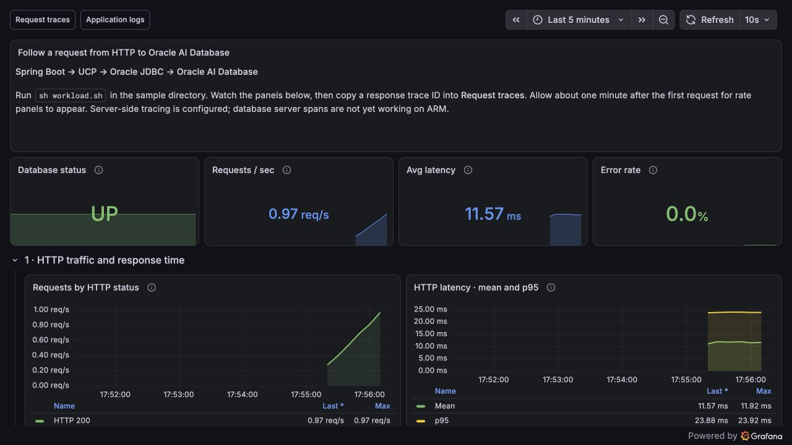
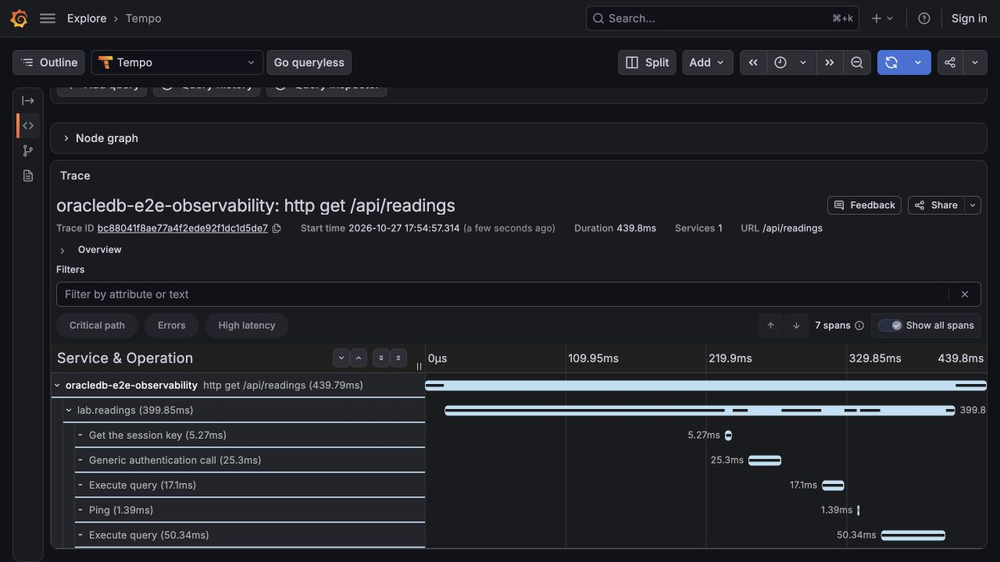
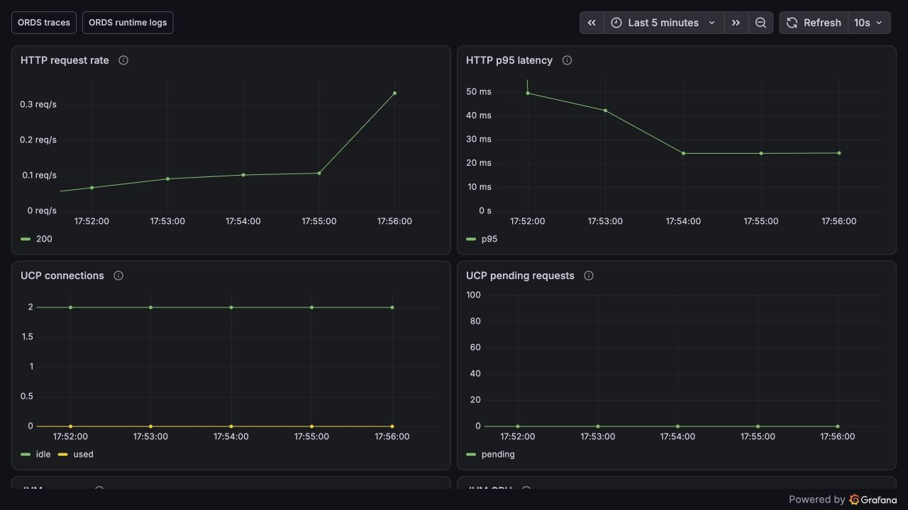
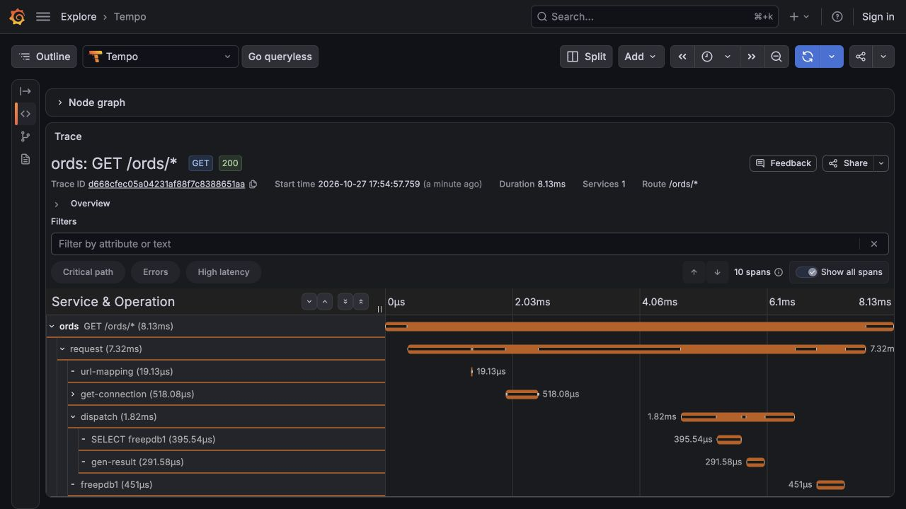

# Observability with Oracle AI Database

This lab connects a small Spring Boot app to Oracle AI Database Free using UCP and the JDBC observability provider. Grafana LGTM receives application/JDBC traces, correlated Logback logs, HTTP/JVM/UCP metrics, and database metrics. Database-native span export is configured through `DBMS_OBSERVABILITY` and an HTTPS proxy (The database spans require HTTPS, hence the proxy for local Grafana LGTM).

An optional Oracle REST Data Services (ORDS) container exposes the same application data over REST. Its OpenTelemetry Java agent exports metrics, logs, and traces to LGTM independently of the Spring Boot application.

| Service | Purpose                                                                                                                                                 |
| --- |---------------------------------------------------------------------------------------------------------------------------------------------------------|
| Oracle AI Database Free | `container-registry.oracle.com/database/free:latest`, seeded application schema, monitoring account, and database observability configuration.          |
| Oracle AI Database Metrics Exporter | Collects database metrics every 15 seconds and pushes them to LGTM over OTLP/gRPC.                                                                      |
| Grafana LGTM | Grafana, Loki, Tempo, Prometheus, and an OpenTelemetry Collector with disposable container storage and a provisioned lab dashboard.                               |
| NGINX | HTTPS entry point for Grafana, exporter metrics, and database OTLP/HTTP; dynamically generates certificates signed by a container-local CA on startup. |
| ORDS (optional) | REST services and the MongoDB API connected to the same Oracle AI Database Free instance; enabled with `--profile ords`. |
| Spring Boot application (host Maven process) | `GET /api/readings`, a real query through UCP, session identity, and managed Micrometer/OpenTelemetry export.                                           |

**ARM limitation:** Server-side tracing is configured, but database server spans are not yet working on ARM architectures. Application and JDBC telemetry work on ARM.

## Start the lab

Install JDK 21+, Maven, and Docker with Compose v2. Allocate at least 8 GB of memory to Docker for this stack. Compose supplies all required defaults, including ports and lab credentials; no environment file is needed. The official full image includes the `orapki` wallet tool. Compose sets `ORACLE_PWD` and mounts the bootstrap scripts under `/opt/oracle/scripts/startup`.

```bash
cd oracledb-e2e-observability
docker compose up -d --wait --wait-timeout 900
```

Compose runs the four infrastructure services. The first database start initializes the schemas and restarts the instance once to activate `WALLET_ROOT`. Startup scripts install the CA trust wallets, network ACLs, and OTLP endpoint.

Run the app in a separate terminal from this module directory:

```bash
mvn spring-boot:run
```

The Maven plugin enables the Oracle JDBC OTEL tracer and stable database semantic conventions. Defaults connect to `localhost:1521/FREEPDB1`, export telemetry to `http://localhost:4318`, and serve the app on port 8081. Stop the app with Ctrl+C.

Open [Grafana](http://localhost:3000), then open **Dashboards → Oracle AI Database → Oracle AI Database end-to-end observability**.

| Endpoint | Address |
| --- | --- |
| Grafana | `http://localhost:3000/` |
| Grafana through HTTPS proxy | `https://localhost:8443/` |
| Direct app / Actuator | `http://localhost:8081/api/readings` / `http://localhost:8081/actuator/health` |
| Exporter metrics | `https://localhost:8443/metrics` |
| Host OTLP/HTTP base URL | `http://localhost:4318` |
| Host OTLP/gRPC endpoint | `localhost:4317` |
| Database HTTPS OTLP base URL | `https://nginx:443` (inside Compose) |
| HTTP redirect | `http://localhost:8080/` |
| Oracle AI Database Free | `localhost:1521/FREEPDB1` |
| ORDS readings (optional) | `http://localhost:8888/ords/lab/readings/` |
| ORDS MongoDB API (optional) | `localhost:27017` |

## Optional ORDS container

Activate the `ords` profile to create ORDS alongside the four infrastructure services:

```bash
docker compose --profile ords up -d --build --wait --wait-timeout 900
```

A normal `docker compose up` does not create ORDS. Use `--profile ords` to include it.

ORDS waits for the existing database to become healthy, then installs its metadata into `FREEPDB1`. Its HTTP endpoint is `http://localhost:8888/ords/`, and its MongoDB API listens on `localhost:27017`. Override the host ports with `ORDS_HTTP_PORT` and `ORDS_MONGO_PORT`. Both ports bind to loopback. APEX is disabled, and ORDS configuration stays inside the container, matching the lab's disposable database storage.

The ORDS image includes OpenTelemetry Java agent **2.33.1**, downloaded with SHA-256 verification during the build. The launcher attaches it only to `ords serve`, leaving installation and SQLcl commands uninstrumented. The agent sends HTTP/JDBC traces, JVM/HTTP/UCP metrics, and Java Util Logging records directly to LGTM over OTLP/HTTP at `http://grafana-lgtm:4318`, with `service.name=ords`. Runtime logs also remain in `docker compose logs ords`. HTTP access-log files and container-entrypoint output are not Java log records and are not exported by this bridge.

After installing ORDS, a startup hook enables the `LAB_APP` schema at `/ords/lab/` and exposes a read-only view of `LAB_READINGS` as `/ords/lab/readings/`. This public local-demo endpoint returns the same seeded readings as the Java app; writes to the view are rejected.

```bash
curl --fail http://localhost:8888/ords/lab/readings/
curl --fail --get --data-urlencode 'q={"sensor":"temperature"}' http://localhost:8888/ords/lab/readings/
```

The collection response contains `items` with the temperature reading (`id=1`, `value=23.5`) and humidity reading (`id=2`, `value=42`). The filtered request returns only the temperature reading. ORDS queries `LAB_APP.LAB_READINGS_REST`, a read-only view over the original table, so the Spring Boot sample continues to use the same data.

Generate continuous ORDS traffic without running the Spring Boot application:

```bash
ORDS_URL=http://localhost:8888/ords/lab/readings/ ./workload.sh
```

Open **Dashboards → Oracle AI Database → ORDS observability** for HTTP request rate/p95 latency, UCP usage/pending requests, JVM memory/CPU, and runtime logs. The dashboard includes links to ORDS traces and logs in Explore. Without the ORDS profile, these panels show no data.

The lab provisions only its Oracle AI Database and ORDS dashboards; the LGTM image's bundled JVM Overview and RED Metrics dashboards are replaced by the lab provisioning configuration.

Use these queries in Grafana **Explore**:

| Signal / data source | Query | What to inspect |
| --- | --- | --- |
| Traces / Tempo | `{ resource.service.name = "ords" }` | HTTP server span and JDBC child spans, including the query against `LAB_READINGS_REST`. |
| Logs / Loki | `{service_name="ords"}` | ORDS runtime messages, severity, and `trace_id` on records emitted inside an active span. |
| Metrics / Prometheus | `sum by (state) (db_client_connections_usage{service_name="ords"})` | Used and idle connections in the ORDS UCP pool. |

HTTP metrics use `http_server_request_duration_seconds_count` and `http_server_request_duration_seconds_bucket`; JVM memory uses `jvm_memory_used_bytes`. Metrics export every 15 seconds, and rate/p95 panels need about a minute of traffic. The container health check queries the readings endpoint every 10 seconds, so HTTP metrics include those requests even when the workload is stopped.

To exercise error logging and trace correlation, attempt a write to the read-only view:

```bash
curl -i -H 'Content-Type: application/json' \
  -d '{"id":999,"sensor":"test","value":1}' \
  http://localhost:8888/ords/lab/readings/
```

ORDS rejects this request with HTTP `555` and `ORA-42399` (DML on a read-only view); no reading is inserted. In Loki, use `{service_name="ords"} |= "POST" |= "555"`, inspect the record's `trace_id`, and open that trace in Tempo to see the failed SQL under the HTTP request.

The agent exports existing runtime log records; it does not create a log entry for every HTTP request. Ordinary startup logs have no request trace. ORDS JDBC spans do not establish database-native server span export or MongoDB wire-protocol tracing.

Oracle documents the [ORDS Java agent integration](https://docs.oracle.com/en/database/oracle/oracle-rest-data-services/26.3/ordig/deploying-and-monitoring-oracle-rest-data-services.html). The agent's [Java Util Logging bridge](https://explorer.opentelemetry.io/java-agent/instrumentation/java-util-logging) exports runtime log records without a separate log collector.

To remove an ORDS container that was previously enabled, bring the stack down before starting it without the flag:

```bash
docker compose --profile ords down
docker compose up -d --wait --wait-timeout 900
```

## Generate traffic and explore telemetry

```bash
./workload.sh
```

Stop the continuous workload with Ctrl+C. The response contains two readings, the current trace ID, and the database-observed module/action/client ID and session ID. `X-Client-Id` accepts 1–64 ASCII letters, digits, dots, underscores, or hyphens. Each decorated connection borrow resets session identity before applying the request's client ID.

Application logs remain available as JSON in the Maven terminal, including trace and span IDs for logs written inside a span. The same logs are exported through the OTLP Logback appender to Loki.

In **Explore**, select **Tempo**, paste the returned trace ID, and inspect the HTTP, `lab.readings`, and JDBC `Execute query` spans. Use the Tempo-to-Loki navigation to find the request log with the matching trace ID; Loki includes `trace_id` and `span_id` metadata. A complete database-exporting environment should additionally show an `oracle-db` server span parented by the JDBC span.

The dashboard opens with database health, request rate, latency, and error percentage. HTTP panels compare mean and p95 latency. UCP panels show capacity, utilization, pending requests, mean/peak acquisition time, borrow/return rates, and failed acquisitions. Database panels show sessions, PDB tablespace utilization, exporter query errors, and collection duration. Use **Request traces** and **Application logs** at the top to open the corresponding Explore view.

Rate panels need ongoing traffic and about one minute of samples after startup. UCP statistics become available after the first database request. UCP meters are also available under `http://localhost:8081/actuator/metrics`.

## Screenshots

These screenshots show the running lab with traffic against the seeded readings. They include application and JDBC telemetry; database-native server spans are not shown.

### Spring Boot application

The application dashboard shows database connectivity, request rate, errors, and HTTP latency:



A request trace connects `GET /api/readings` to the `lab.readings` operation and Oracle JDBC calls:



### ORDS

The ORDS dashboard shows HTTP traffic and latency alongside UCP connection usage and pending requests:



The Java agent captures the ORDS HTTP request, connection acquisition, dispatch, and SQL query for the REST endpoint:



## Database server spans and TLS

The JDBC provider uses Boot's managed SDK and propagates trace context. UCP connection properties select `observability-trace-event-listener-provider` and enable server traces; the connection decorator forces the documented telemetry state transition and sets the trace-level context used in Oracle's example. The controller brackets SQL execution with JDBC `beginRequest()` / `endRequest()` before returning the session to UCP.

Database startup enables the service in the CDB and PDB, registers and enables `https://nginx:443/v1/traces`, enables capture and extra metadata, and grants the application user network access to `nginx:443`. Auto-login trust wallets live at `WALLET_ROOT/<PDB_GUID>/disttrc` and `tls`. The instance's wallet root is stored inside the database container.

NGINX generates a fresh 30-day leaf certificate on every start. The local CA lives inside the NGINX container. Database startup downloads its public certificate from `http://nginx/lab-ca.crt` and imports it into the telemetry wallets.

Application OTLP goes from the host to LGTM through published port 4318. Database-native traces use the HTTPS proxy. JDBC connections use the ordinary Oracle listener. Database alert-log forwarding remains disabled; the required logs here are application logs.

Oracle's [JDBC API documentation](https://docs.oracle.com/en/database/oracle/oracle-database/26/jajdb/oracle/jdbc/OracleConnection.html), [observability administration guide](https://docs.oracle.com/en/database/oracle/oracle-database/26/admin/monitoring-the-database.html), and [server-export example](https://blogs.oracle.com/developers/end-to-end-agentic-ai-observability-tracing-from-agents-into-the-oracle-ai-database-using-the-java-observability-provider-and-server-side-otel-exporter) explain the client and database setup.

## [Optional] Run the Java tests

Run tests from the repository root with JDK 21+ and Maven:

```bash
mvn -pl oracledb-e2e-observability test
```

## Troubleshooting and cleanup

Stop the Maven application with Ctrl+C, and then stop the containers with `docker compose down` (or `docker compose --profile ords down` if ORDS was enabled).

For ORDS startup failures, use `docker compose --profile ords logs ords`. The health check succeeds only when `/ords/lab/readings/` responds successfully, after ORDS installation and schema setup. If ORDS responds but telemetry is missing, check the logs for Java agent startup/export errors and confirm that the `ords` service uses the internal collector address `http://grafana-lgtm:4318`.

If server spans are missing, check the database endpoint configuration, wallet trust, proxy access logs, and database trace files. In Tempo, inspect the request trace for an `oracle-db` span parented by its JDBC span. Server spans are not yet working on the ARM database free image.

Compose uses `container-registry.oracle.com/database/free:latest` with container-local data storage. The container tags can change upstream; pin digests for a repeatable workshop.

Compose publishes Grafana (3000), OTLP/gRPC (4317), and OTLP/HTTP (4318) on loopback.
